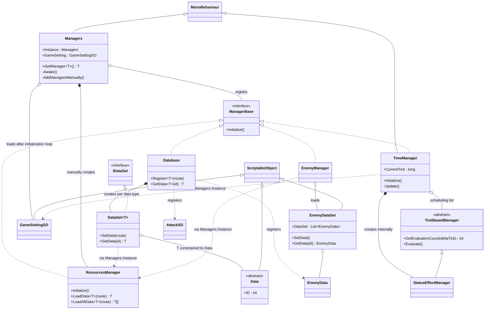
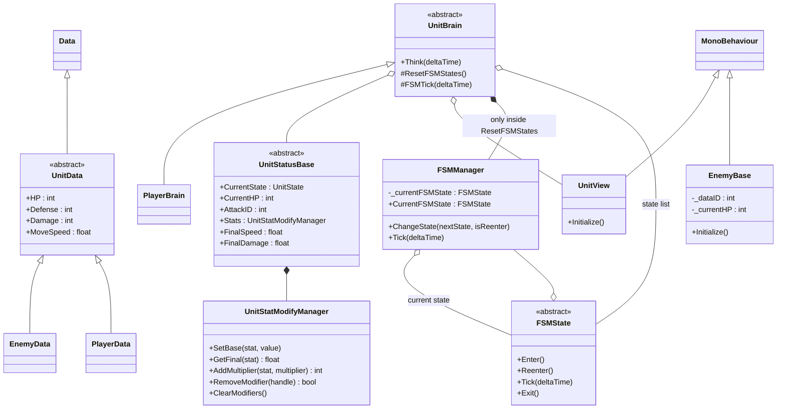
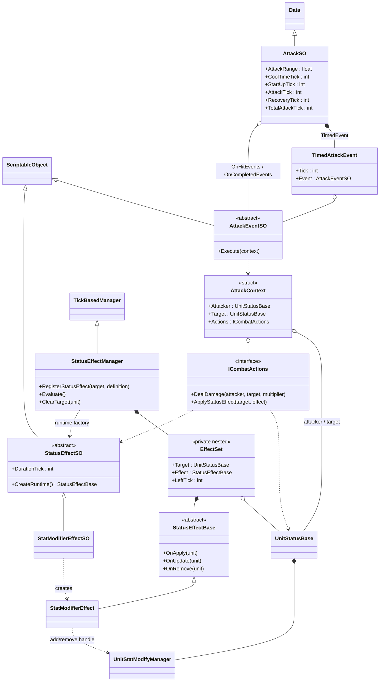
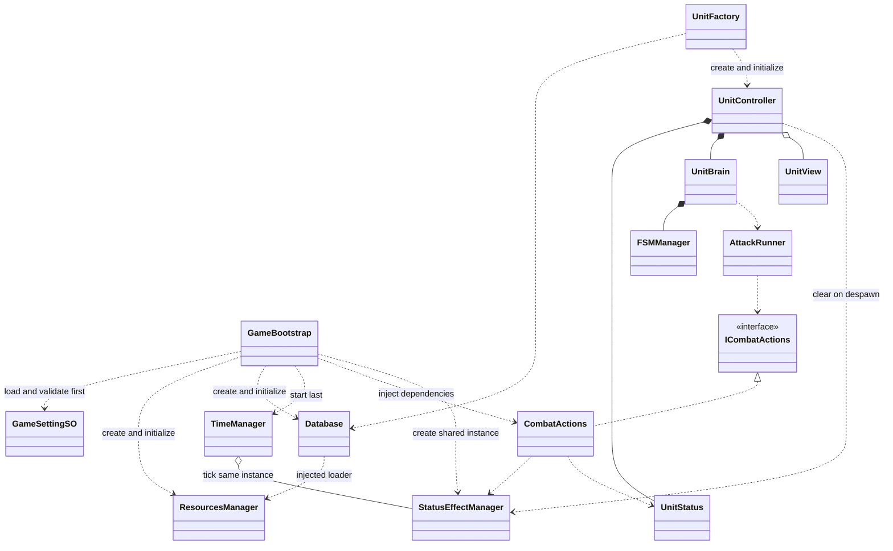

# KillingSlime — 스크립트 UML 및 구조 검토

검토일: 2026-10-16. 범위: `Assets/Scripts`의 C# 파일 33개. 외부 에셋 코드는 참조 검색 대상으로만 사용했다.

## 팀장 관점의 판단

SO 데이터와 런타임 효과를 분리하고, 버프를 핸들로 개별 해제하는 방향은 유지할 가치가 있다. 하지만 현재는 실행 가능한 게임 구조를 완성하기 전의 골격 단계다. 가장 먼저 해결할 일은 추상화 추가가 아니라 **초기화 → 유닛 생성 → 상태 전환 → 공격 → 버프 만료** 한 사이클을 연결하는 것이다.

이 문서는 실제 코드의 관계와 개선안을 구분한다. 코드 수정 및 파일 삭제는 하지 않았다. 아래 줄 번호는 검토 시점 원본 기준이다.

## 1. 현재 UML: 매니저와 데이터

`<|--`는 상속, `<|..`는 인터페이스 구현, `*--`는 내부 생성·소유, `o--`는 참조 보관, `..>`는 사용 의존성이다. 다이어그램에 있는 타입이 모두 실행 시 등록된다는 의미는 아니다.

실제 수동 등록은 `ResourcesManager` 하나다. `TimeManager`는 자식 컴포넌트로 배치되어야 검색된다. 일반 C# 클래스인 `Database`, `EnemyManager`는 현재 수동 생성 코드가 없으므로 이 등록 경로로는 실행되지 않는다.

## 2. 현재 UML: 유닛과 FSM

`UnitData → UnitStatusBase` 변환은 구현되어 있지 않으므로 연결하지 않았다. `EnemyBase` 역시 Brain/Status/View와 연결되지 않았다. `UnitStatusBase`, `FSMState`의 구체 하위 클래스는 검색되지 않았다.

## 3. 현재 UML: 공격과 상태 효과

공격 실행기, `ICombatActions` 구현체, 구체 `AttackEventSO`는 없다. 따라서 위 공격 데이터가 실제 피해나 상태 효과로 이어지는 실행 경로는 아직 없다.

## 4. 수정 우선순위와 근거

P0는 실행 경로를 막는 문제, P1은 기능 정확성과 다음 기능 구현에 직접 영향을 주는 문제, P2는 유지보수 개선이다. 미연결 코드의 문제는 해당 경로를 연결했을 때 발생한다.

| 우선순위 | 문제와 근거 | 영향 / 개선 방향 |
|---|---|---|
| P0 | `Managers.cs:55–61`에서 모든 매니저를 초기화한 뒤 설정을 로드한다. `TimeManager.cs:35–38`은 초기화 도중 `GameSetting`을 사용한다. | TimeManager를 배치하면 설정이 null인 상태로 접근한다. catch는 ArgumentOutOfRangeException만 처리하므로 이 예외는 잡히지 않는다. Resources 초기화 → 설정 로드·검증 → Database → 게임 서비스 → Tick 시작 순서를 명시한다. |
| P0 | `GameSettingSO.cs:13–14`의 readonly 필드 두 개에 대입이 없어 값이 0이다. `TickBasedManager.cs:11–14`는 0 주기를 거부한다. `Assets/Resources`에는 현재 DOTweenSettings만 있다. | 초기화 순서를 고쳐도 유효한 설정과 데이터가 없다. 설정을 직렬화 가능한 private 필드 + 읽기 속성으로 만들고, 양수 기본값 및 검증을 둔다. 지정 경로에 GameSettingSO와 실제 데이터 에셋을 생성한다. MaxEffectCount는 현재 List의 초기 용량일 뿐 상한이 아님도 명시한다. |
| P0 확인 | `Managers.cs:3`에 사용하지 않는 `Unity.AI.Navigation.LowLevel` using이 있지만 manifest/lock 및 생성된 csproj에서 대응 패키지 참조가 검색되지 않는다. | 컴파일 오류 후보다. 사용하지 않는 using을 제거하고 Unity에서 재컴파일해 확인한다. 이 검토에서 컴파일 오류를 재현한 것은 아니다. |
| P1 | `FSMManager.cs:5–6,11–19`의 현재 상태 필드가 두 개이며 전환 시 private 필드만 변경한다. | 일반 전환에서는 이전 상태의 Exit가 실행되지 않고 동일 상태 재진입 차단도 실패한다. 하나의 backing field와 읽기 전용 속성으로 통합한다. Reenter 호출 정책도 정한다. |
| P1 | `UnitBrain.cs:16–21` 생성자에서 FSM을 생성하지 않고 `Think → FSMTick`은 바로 `_fsmManager.Tick`을 호출한다. `ResetFSMStates` 호출자는 없다. | 현재 PlayerBrain 생성 후 Think를 호출하면 null 접근이 발생한다. 기본 FSM 생성은 확정된 초기화 단계에서 처리하고, 구체 상태를 등록한 뒤 첫 상태를 지정한다. 생성자에서 overridable 메서드를 호출하는 방식은 피한다. |
| P1 | `Managers.cs:64–67`은 ResourcesManager만 생성한다. Database/EnemyManager는 MonoBehaviour가 아니다. TimeManager가 만든 StatusEffectManager는 private 목록에만 있다. | 데이터 서비스는 등록되지 않고 외부에서 상태 효과 서비스를 얻을 경로도 없다. 한 부트스트랩에서 필요한 서비스를 생성하고 같은 효과 서비스 인스턴스를 Combat 서비스와 Tick 스케줄러에 전달한다. |
| P1 | `EnemyDataSet.cs:9–16`은 `_dataDict`를 생성하지 않은 채 조회/추가한다. `EnemyManager.Initialize`도 SetData를 호출하지 않는다. Database는 별도 `DataSet<EnemyData>`를 사용한다. | 중복 데이터 체계와 null 오류가 함께 존재한다. 현재 일반화된 Database 방식으로 통합하고 구 EnemyDataSet/로더를 제거하는 쪽을 권한다. |
| P1 | `StatusEffectManager.cs:76–83`은 남은 시간이 0인지 검사한 뒤 감소시킨다. | DurationTick=1은 첫 Evaluate에서 0이 되고 두 번째 Evaluate에서 해제된다. 평가 간격이 k라면 지속시간 단위도 기본 Tick인지 평가 횟수인지 불명확하다. 기본 Tick 기준 만료 시각 또는 deltaTick으로 통일하고, 마지막 갱신과 해제 순서를 명세한다. |
| P1 | `UnitStatusBase`는 일반 C# 객체다. `StatusEffectManager.cs:76`의 null 검사는 게임 오브젝트 파괴나 사망을 감지하지 못한다. ClearTarget 호출자는 없다. | 사망/풀 반환 후 효과가 잔존할 수 있다. 유닛 수명주기 종료 시 효과 해제를 연결한다. 풀 재사용 시 Stats 초기화와 효과 목록 제거를 함께 처리한다. |
| P1 | `AttackSO`의 시간/이벤트 데이터에는 실행 주체가 없다. `UnitData.MoveSpeed`는 float지만 `UnitStatusBase.Speed`는 int이며 데이터 복사 경로도 없다. | 공격 한 사이클을 먼저 완성한다. UnitFactory 또는 초기화 함수에서 HP·기본 스탯을 복사하고 이동속도 타입을 float로 통일한다. |
| P2 | `DataSet.cs:22`, TimeManager, EnemyManager가 전역 Managers를 직접 조회한다. | 생성/테스트에 전역 환경이 필요하고 초기화 의존성이 숨겨진다. Bootstrap에서 구체 객체를 조립하고 생성자/Initialize 인수로 필요한 의존성만 전달한다. DI 프레임워크 도입은 현재 필수가 아니다. |
| P2 | `TimeManager.cs:77`은 지연량만 계산하고 `MaxDelayTick`은 사용하지 않는다. FSM은 float deltaTime, 공격/효과는 Tick이다. | 장시간 프레임 지연 후 따라잡기 정책과 전투 시간 기준을 정한다. 프레임당 5회 제한은 유지할 수 있으나 지연을 보존/폐기할 조건을 명시한다. 이동·화면 보간과 전투 시뮬레이션의 시간 경계를 구분한다. |
| P2 | `ResourcesManager.LoadData`의 캐시 키는 경로만이고 LoadAllData는 타입도 포함한다. | 같은 경로를 다른 타입으로 요청하면 잘못된 캐스트 가능성이 있다. `(Type, path, loadMode)` 키로 통일한다. 아직 Addressables 전환부터 할 필요는 없다. |
| P2 | 효과 목록은 해제 때 RemoveAt으로 뒤를 이동시키고 ClearTarget은 전체를 순회한다. 효과의 갱신 콜백 중 목록 변경 규칙도 없다. | 현재 규모에서는 유지 가능하다. 대규모 전투가 목표면 계측 후 대상별 인덱스, 순서 무관 시 swap-remove, 등록/해제 대기열을 검토한다. 먼저 중첩·갱신·해제 정책을 확정한다. |
| P2 | `UnitStatModifyManager.cs:48–74`는 배율을 누적 곱셈/나눗셈하며 0 배율을 거부한다. | 이동 불가를 0 배율로 표현할 수 없고 장기 중첩 시 수치 오차·과대값 문제가 가능하다. 행동 금지는 별도 상태로 표현하고, 고정 가산/배율/상한의 계산 순서를 콘텐츠 필요에 맞춰 정의한다. |

## 5. 불필요한 파일과 코드 후보

정적 검색에서 참조가 없다는 사실만으로 Unity 파일을 즉시 삭제하지 않는다. 이번 검색에서는 자체 스크립트 33개의 `.meta` GUID가 `Assets`의 `.unity/.prefab/.asset` 텍스트에서 한 번도 발견되지 않았다. Resources 경로와 Assets 전체의 C# 참조도 함께 확인했다. 저장되지 않은 에디터 상태, 외부 파일, 동적 로딩까지 부재를 보장하지는 않는다.

| 판단 | 대상 | 근거와 처리 |
|---|---|---|
| 통합 후 삭제 권장 | `Enemy/EnemyDataSet.cs` | Database + DataSet<EnemyData>와 중복이다. 현재 에셋 참조 없음. 데이터 통로를 Database로 확정한 뒤 삭제한다. |
| 위 정리와 함께 제거/재작성 | `Managers/EnemyManager.cs` | 현재 역할은 구 EnemyDataSet 로드뿐이며 생성·등록 호출이 없다. 향후 스폰/활성 적 관리 역할로 구현할 계획이면 클래스 이름은 유지해도 된다. |
| 파일 일부 정리 | `Enemy/EnemyDefine.cs`의 EnemyDefines/EnemyDataSetRoute | 구 로더를 없애면 불필요하다. 같은 파일의 EnemyData와 분류 enum까지 함께 삭제하면 안 된다. |
| 미사용 선언 삭제 후보 | `Defines/Defines.cs`의 FrameEvent, `AttackDefines.cs`의 AttackTrigger/EffectTarget, `UnitDefines.cs`의 UnitStatusAdderType | 선언 외 참조가 없다. FrameEvent는 AttackEventSO와 역할 중복 가능성이 있고 스탯 enum도 StatType과 겹친다. 실제 요구가 나오기 전에는 제거를 권한다. 파일 전체 삭제 대상은 아니다. |
| 기능 계획에 따라 정리 | `EnemyBase.cs`, `PlayerBrain.cs`, `PlayerData.cs`, `UnitView.cs` | 비어 있거나 전달 생성자만 있지만 미완성 기능의 진입점일 수 있다. 당장 불필요한 파일이라고 단정하지 않는다. 유닛 한 종류를 완성하면서 실질 책임을 부여하거나 통합한다. |
| 유지 | `IDataSet.cs`, `ManagerBase.cs` | IDataSet은 빈 인터페이스지만 이종 DataSet을 Dictionary에 보관하는 제약으로 실제 사용된다. ManagerBase도 실제 인터페이스다. 단순히 빈 파일/이름만 보고 삭제하지 않는다. ManagerBase는 IManager로 이름을 맞추면 이해가 쉬워진다. |
| 멤버 정리 | `FSMState.Reenter`, `UnitView._currentPosition`, `EnemyBase._currentHP`, `TimeManager._delayedTick` | 현재 호출/유의미한 사용이 없다. 기능을 연결하거나 제거한다. MaxDelayTick은 지연 정책을 구현할 경우 유지한다. |
| 낮은 우선순위, 범위 밖 | `Assets/Welcome`, SPUM Sample/도구 씬, 몬스터 DemoScene | 게임 코드 분석 대상은 아니다. 튜토리얼/샘플 미사용 여부 및 에셋 의존성을 확인한 뒤 정리할 수 있다. SPUM 본체와 DOTween은 자체 스크립트에서 호출이 없어도 에디터/프리팹 의존성이 있어 삭제를 권하지 않는다. |

이름은 `Attak&Skills/Attaks` → `Combat/Attacks`, `Buff&Debuff` → `StatusEffects`처럼 정리할 수 있다. Unity 에디터에서 이동하여 `.meta`를 보존한다. `EnemyData`가 `EnemyDefine.cs`, `AttackEventSO`가 `AttackDefines.cs` 안에 있는 것도 자산 타입 탐색·스크립트 연결의 혼동을 줄이도록 별도 동명 파일로 분리할 후보다. 실제 기존 에셋이 생긴 뒤에는 연결을 검증하며 이동한다.

## 6. 권장 구조 UML — 앞으로의 제안

아래 클래스는 개선안이며 현재 구현되어 있다는 뜻이 아니다. 현재 규모에서는 서비스마다 인터페이스를 만드는 것보다 의존성 전달과 책임 분리가 우선이다.

UnitController는 Unity의 생성·활성·비활성·풀 반환을 묶고, UnitStatus는 현재 체력과 스탯, Brain은 판단, View는 표현만 맡는다. AttackRunner는 공격 단계와 이벤트를 진행하고 CombatActions는 실제 피해/효과 적용을 담당한다. SO에는 실행 중 변하는 상태를 저장하지 않는다.

## 7. 실행 순서와 완료 기준

1. **부팅 복구:** 불필요한 namespace 참조 확인, 설정/데이터 에셋 준비, 초기화 순서 고정, 필요한 서비스 등록. 새 씬에서 예외 없이 시작하고 데이터 ID 조회가 성공하면 완료.
2. **유닛 하나 완성:** 데이터에서 런타임 상태 생성, FSM 초기화/전환 수정, Think 호출 주체 연결. A→B 전환에서 A.Exit/B.Enter가 각각 한 번 실행되고 동일 상태 재진입 정책이 지켜지면 완료.
3. **전투 한 사이클 완성:** AttackRunner + ICombatActions 구현, 피해 적용, 버프 부여/만료, 사망/풀 반환 시 정리. 유닛 한 쌍으로 실제 동작을 확인한다.
4. **정리 및 확장:** 구 EnemyDataSet 체계와 미사용 선언 제거, 명명/폴더 정리, 필요한 경계에만 asmdef 도입. 콘텐츠 증가 시 효과 중첩 정책과 스탯 공식을 확장한다.

핵심 검증 시나리오: DurationTick=1/2 및 평가 간격>1의 정확한 만료 시점, 동일 스탯 버프 두 개 중 하나만 해제, 효과 중 대상 사망/풀 재사용, FSM A→B 및 동일 상태 요청, 누락 설정/중복 데이터 ID, 프레임 지연 후 Tick 정책. 이 검토에서는 테스트 코드를 추가하거나 Unity 실행 테스트를 수행하지 않았다.

## 검토 방법과 한계

- 자체 스크립트 33개 전체를 읽고 생성·등록·호출 및 상속 관계를 검색했다.
- `.meta` GUID를 Assets 내 씬·프리팹·SO 에셋과 대조했다. `Assets/Resources`의 실제 내용도 확인했다.
- Unity 버전은 ProjectVersion.txt 기준 6000.6.0f1이다. 패키지 manifest/lock과 생성된 프로젝트 참조를 정적으로 확인했다.
- Mermaid 다이어그램은 코드 관계를 수동 대조했다. 별도 렌더러 검증은 하지 않았다.
- Unity 컴파일/플레이/빌드 검증은 수행하지 않았다. 컴파일 후보와 확정된 코드 논리 문제를 구분했다.
- Git 상태 조회는 상위 경로 접근 오류로 실패했다. 기존 변경 여부를 판정하지 않았으며 이 문서 외 원본은 수정하지 않았다.
